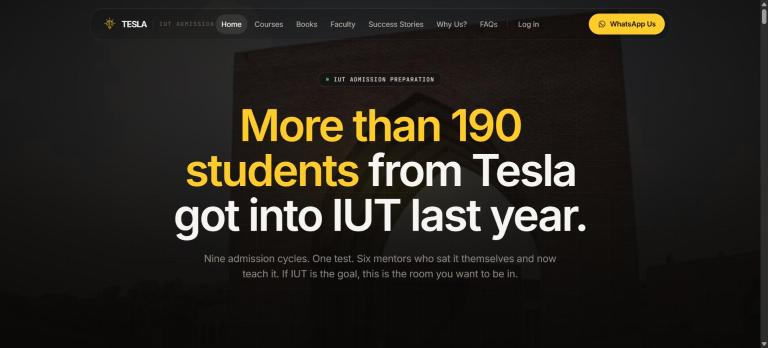
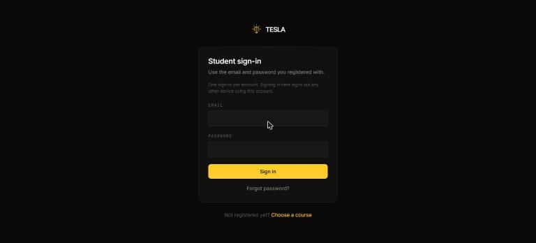

# Tesla — an LMS for an admission-prep programme

A learning management system that runs a whole coaching business: the public
site that sells the courses, the enrolment and payment review behind it, and
three signed-in portals for students, teachers and the admin.

**Live:** [iutadmissioncourse-tesla.com](https://iutadmissioncourse-tesla.com)

> This is a case study. The source is a private client repository — I am happy
> to walk through it, or grant read access on request.

`Next.js 16` · `React 19` · `TypeScript` · `Tailwind CSS v4` · `PostgreSQL` ·
`Drizzle ORM` · `Vercel` · plus a `Flask` exam engine

---



## The problem

Tesla is an admission-test preparation programme in Bangladesh. Before this,
the whole operation ran by hand: enquiries over WhatsApp, fees paid by bKash
and checked against a phone screen, class links pasted into Facebook groups,
and a spreadsheet trying to hold it together.

What they needed was not a website. It was the system underneath one —
somewhere an enrolment could be reviewed, a payment verified, a student
given access, and a class delivered.

## What it does

| Surface | Who | What they can do |
| --- | --- | --- |
| Public site | anyone | Read the course offer, order the book, start an enrolment |
| Enrolment | prospective student | Submit details, photo and a bKash transaction, in one or two instalments |
| Student portal | approved student | Live class link, class recordings, routine, notices, e-books, model-test exams |
| Teacher portal | teachers | Live class link, routine, notices, class recordings |
| Admin panel | admin | Review enrolments, orders, reviews, courses, e-books, tracking |

**By the numbers:** 19 PostgreSQL tables · 17 migrations · 30 pages ·
8 API routes · ~14,000 lines of TypeScript · 3 roles · 2 applications.


## Payments without a payment gateway

Card payment is not how this market pays. Students send the fee by **bKash**
and submit the transaction ID; the admin checks it against their own bKash
statement and approves.

That makes the software's job clear: make the review fast, and make a mistake
hard.

- A transaction ID can only ever back **one** payment. The same ID on a second
  enrolment, a second course or a second student is refused — compared
  case-insensitively with whitespace stripped, because people paste them
  inconsistently.
- Fees can be paid in **two instalments**. A student permitted the second step
  can submit it; everyone else is told where their enrolment stands.
- An approval emails the student their sign-in details automatically.

## Architecture

```
Browser ──► Next.js 16 on Vercel ──► PostgreSQL (Neon)
                  │                        ▲
                  │  single-use HMAC       │
                  │  sign-on ticket        │
                  ▼                        │
            Flask exam engine ─────────────┘
              (its own database)
```

Three roles, three cookies, three lifetimes — admin, teacher and student each
hold an HS256 JWT in an httpOnly cookie. Edge middleware checks the cookie
before a page renders, but **that is an optimistic redirect, not
authorisation**: every server action and route handler re-verifies the session
before it touches data.

The marketing page is statically generated and revalidated hourly, and every
admin write pushes the change out immediately rather than waiting. The portals
are per-user and fully dynamic.



## Decisions I would defend in a review

**Single sign-on between two frameworks, with nothing shared but a secret.**
Model tests run on a separate Flask application. Rather than give students a
second password, Next.js mints a single-use HS256 ticket; Python verifies it
with the standard library's `hmac` and marks it spent, so a forwarded exam
link is already used. Password sign-in on the exam side is disabled entirely —
the only way in is an approved enrolment on the main site. No JWT library on
the Python side; it is an HMAC comparison, and a dependency would have been
weight for nothing.

**Rate limiting lives in Postgres, not memory.** On serverless each request
may land on a different instance, so an in-memory counter resets constantly
and counts nothing. The database is the only thing every instance shares. It
costs a query, which for these endpoints is the right trade.

**The e-book reader aims at accountability, not prevention.** Anything a
screen can show, a camera can photograph — so claiming the PDFs are
unextractable would have been a lie. Instead they sit in private storage
behind an authenticated route, render to canvas via `pdf.js` so there is no
file URL to copy, pause when the tab loses focus, and carry the reader's own
name and email watermarked across every page. If a page leaks, it says who
leaked it.

**Subjects are stored as text, not a database enum.** The application already
restricts the values, and storing text meant that when Physics later split
into 1st and 2nd paper, going from four subjects to seven was a one-line
change instead of a migration and a coordinated deploy.

**Nothing is tracked before consent.** No analytics script is fetched at all
until a visitor accepts — stricter than Consent Mode alone, and exactly what
the privacy page promises, so the code and the promise match. Conversions are
also reported server-side with one-way hashed customer data and a shared event
id, so a sale reported from both the browser and the server is counted once.

**Teacher accounts are created unusable.** A new teacher account gets a random
password nobody holds, so an admin has to set one before anyone can sign in.
It previously had a fixed default written in the source, which is a published
password — unusable by default beats guessable by default.

## Operations

- **Deploys** — Vercel from `main`. The build applies database migrations
  before it builds, so schema and code ship together or not at all.
- **Backups** — a nightly job dumps both databases, copies source and config,
  pushes to a private repository and mirrors to Google Drive. Two days are
  kept and older ones pruned, in all three places.

## What I would do next

Worth stating plainly rather than leaving to be discovered:

- **Automated tests**, starting with the enrolment and payment rules — that is
  where a bug costs money.
- **Alerting.** Failures are logged but nothing shouts. A revoked email
  credential once broke every transactional message for a day without anyone
  noticing, because only failures are logged and silence looks like a quiet
  day. Silent failure is worse than loud failure.
- **A queue for bulk email**, which currently sends inside the request.

## A note on the screenshots

Only public pages are shown. The admin and student portals hold real students'
names, emails, photographs and payment records, so they are not screenshotted
here. I can demonstrate them live.
